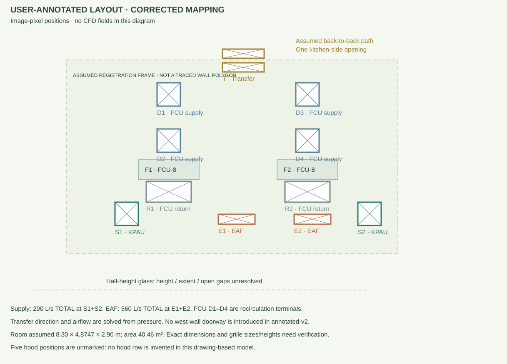

# User-annotated HVAC layout — corrected mapping

The second, annotated crop resolves the terminal identities. It supersedes the first candidate review: **the lower square grilles are KPAU, and the narrow lower slots are EAF**. The earlier candidate assignment was reversed. No additional KPAU supply is allocated to the four FCU diffusers.

This is a manual symbol transcription in pixels from the 1217 × 720 px annotated crop. The dashed rectangle is an **assumed registration frame**, not a traced/verified wall polygon.

| Component | User-confirmed image positions (approx. px) | New model treatment |
|---|---|---|
| KPAU S1 / S2 | Square grilles at (304,514), (887,514) | Two ceiling supply patches; **290 L/s total**, split equally; 15°C / 86% RH baseline. Nominal 0.62 × 0.62 m faces assumed. |
| EAF E1 / E2 | Narrow crossed slots at (568,527), (750,527) | Two ceiling extraction patches; **560 L/s total**, split equally. Nominal 0.90 × 0.28 m faces assumed. |
| FCU D1–D4 | Squares at X=405/738, Y=227/338 | Four FCU supply annotations; local momentum/cooling actuators below these positions when enabled. UA per FCU is divided between its two outlets. |
| FCU R1 / R2 | Broad grilles at (404,461), (740,461) | Return locations displayed. Internal duct and return-to-supply connections are not resolved by the actuator approximation. |
| FCU F1 / F2 | Two FCU-8 boxes near (404,406), (740,406) | Above-ceiling housing markers only; the ceiling void is excluded from the CFD domain. |
| Transfer T | Crossed pair near (584,129), (584,162) | Assumed one back-to-back path through the upper wall, not two independent kitchen inlets. One model opening, nominal 0.90 m wide at Z=2.35–2.85 m, split into pressure face groups. Height, free area and assembly remain unverified. |

## Scale and remaining physical assumptions

- Area remains **40.46 m²**. Length is provisionally **8.30 m** and width **40.46/8.30 = 4.8746988 m**. The image rectangle (160,144)–(955,610) sets relative positions only. Exact perimeter and dimensions need a dimensioned plan.
- Clear ceiling remains **2.9 m**, structural ceiling **4.8 m**. The “2700 CL” service note does not replace those instructed heights.
- Supply/exhaust faces are assumed at the false ceiling. Downward supply direction and grille free areas are assumptions; four-way discharge data are missing.
- Transfer uses physical total-pressure/inlet-outlet conditions with hydrostatic and inlet kinetic-head corrections. Flow direction is solved, with no fixed makeup-air boundary. The old west-wall doorway is absent from this version.
- The half-height-glass note does not establish an open gap. The model assumes an impermeable partition pending its height, extent and opening details.
- FCUs remain sensible-only local actuator models. Their return grilles are located, but duct mass transport, fan curves, coil condensation and radiation are not resolved.
- CHWS/CHWR and CD annotations are not ventilation paths. Far-right 90 L/s adjacent-zone exhaust labels are excluded from the kitchen total.

## Five hood positions remain unmarked

No five-hood row is invented in **annotated-v2**. It supports the requested baseline (hoods OFF, cooking gains zero), and FCU toggles use the mapped supply positions. Runs with hood exhaust or cooking gains are rejected until the five hood/cooking-station locations are supplied. The earlier **provisional-v1** model and its assumed hood row remain available explicitly for historical comparison.

Please identify the five hoods/cooking stations relative to the two FCU-8 units. A dimensioned plan or full sheet would additionally verify room boundaries, opening sizes/heights and the glass partition.

## Versioned results

Existing `cases/baseline` and the earlier cooking result belong to **provisional-v1**, not this drawing. The new baseline is generated separately in `runs/layout-baseline-v2` from `examples/annotated-baseline.json`. Solver checks, logs and case provenance are evaluated again; old fields are never repositioned onto the new geometry.
